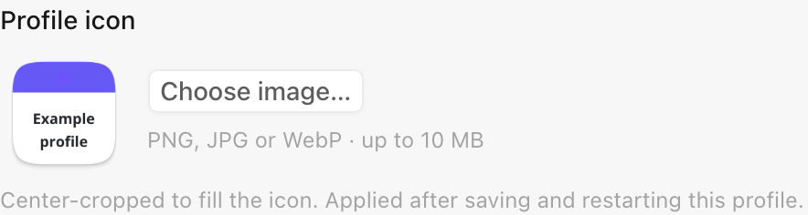
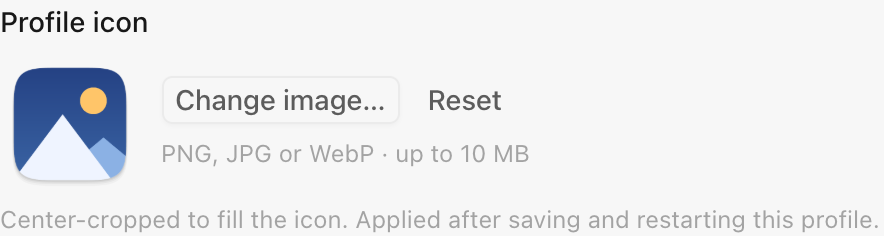
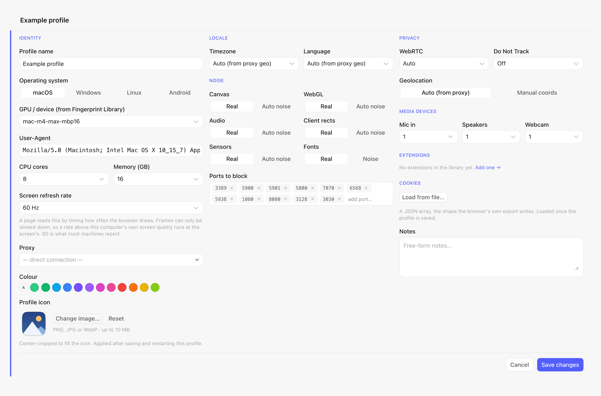

# Custom profile icons

Open a profile's expanded editor and use **Profile icon**, beneath **Colour**,
to choose a PNG, JPEG or WebP image. The preview shows the same image and frame
that the browser receives. Use **Reset** to restore the generated name badge.
Save the profile, then restart that profile's browser for the new icon to appear.

Images are center-cropped to a square and fill the existing platform-specific
shape. macOS retains its squircle, margin and shadow; Windows and Linux retain
their existing geometry. The custom image replaces the accent band and name
inside the icon. The profile name and colour in the browser UI stay available.

| Generated icon | Custom image |
| --- | --- |
|  |  |



The screenshots use a synthetic **Example profile** and an original geometric
sample avatar. They show the real editor in a browser harness with native I/O
stubbed; both icon previews were generated by the actual Rust renderer.

## Persistence and API behaviour

The launcher saves a normalized 512 × 512 RGBA PNG as base64 in
`_meta.icon_png`. This keeps the image portable across profile clone,
export/import and data-root moves without depending on the original file path.
The metadata is excluded from the fingerprint JSON supplied to the engine.

- Missing image: existing generated badge and cache key are unchanged.
- Custom image: render cache is keyed by image content, independent of name or colour.
- Reset: the editor sends `icon_png: null`.
- Older API clients omitting the field preserve the current image when updating a profile.
- Image changes participate in profile revision checking.

Uploads are decoded locally. Supported formats are PNG, JPEG and WebP, up to
10 MiB, with a maximum dimension of 8192 pixels and a 64 MiB decoder allocation
limit. Persisted/imported icon values must be normalized RGBA PNGs.

Older launcher builds do not understand the new metadata field and may drop it
when rewriting a profile. Keep a profile export or image backup before downgrading.

## Verification

```sh
npm run build
npm run check:i18n
cargo test --manifest-path src-tauri/Cargo.toml --release --lib --features tauri/custom-protocol profile_icon::tests
```

Native tests cover supported formats, center crop, malformed/oversized input,
transparent icon margins, cache identity, missing source files, default fallback
and metadata serialization. To check the UI manually:

1. Open an existing profile with no custom image; the name badge still appears.
2. Choose a landscape/portrait image; verify the preview is center-cropped.
3. Save, reopen the editor and relaunch the profile; the image persists.
4. Rename the profile, change its colour or remove the original image file;
   the saved image remains available.
5. Choose **Reset**, save and relaunch; the generated badge returns.
6. Choose an image and cancel the editor; the previous saved value is retained.
7. Cancel the file picker or choose a corrupt/oversized image; the prior value
   remains intact and Save becomes available after the operation finishes.
